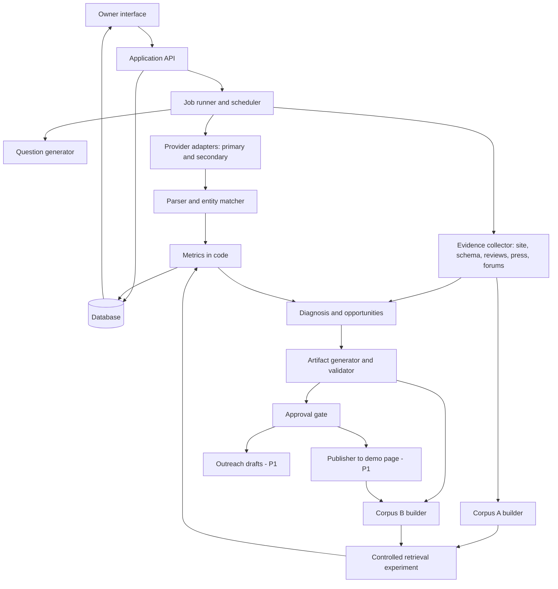

# Restaurant AI Visibility Agent

Product requirements document · Version 1.1 · October 20, 2026

Status: Implementation in progress. A local synthetic prototype exists; see docs/implementation.md for delivered scope. This version supersedes v1.0.

Event: NYU SPS X Pulse Foundry Hackathon, Friday October 23, 2026, 9:00 AM to 7:00 PM, NYU SPS MTC Rooms 1026 and 1027.

## 0. What changed from v1.0

| Area | v1.0 | v1.1 |
|---|---|---|
| Discovery | One AI provider | Two providers in P0 (second adapter required if any second key is available) |
| Analysis evidence | Own website first, listings vague | Explicit review and listing evidence (Google, Yelp), press, Reddit/forums for target and competitors |
| Recommendations | Mostly website content | Website, structured data, and off-site actions (reviews, press, local blogs) |
| Artifacts | About, FAQ, menu copy, Restaurant/Menu schema | Adds FAQPage schema, local landing page, outreach email drafts |
| Measurement | Manual two-run comparison; controlled experiment P1 | Controlled before/after retrieval experiment is P0; scheduled re-run and trend chart are P0 |
| Autonomy | Approval-gated publish P1 | Still P1, now linked to the controlled experiment (publish then re-measure) |
| Hardening | Idempotency, SSRF, auth, 13-entity audit trail | Collapsed into a short demo-safe checklist; full versions deferred |
| Plan | Generic sequence | Pre-event prep plus hour-by-hour event-day build plan |

## 1. Purpose and source of requirements

Build an agent that helps a restaurant owner understand how their business appears in AI-generated restaurant recommendations, explains why competitors win, generates usable fixes, and measures change over time.

Source brief: **NYU SPS X Pulse Foundry.pdf**.

The brief requires a Discovery → Analysis → Action → Measurement loop. Its deliverables are:

- A working demo on at least one restaurant.
- A visibility report against named competitors with specific reasons for the gap.
- Generated artifacts the restaurant could use.
- A measurement mechanism.
- As a bonus, a real autonomous action with human approval.

Judging criteria: discovery depth, analytical rigor, actionability, autonomy (bonus), measurability, and a three-minute demo that shows "what's broken, what we fixed, proof it worked."

Unless a requirement is marked as coming from the brief, the formulas, thresholds, and scope numbers below are our own product decisions.

## 2. Product outcome

**Product promise:** "See where your restaurant is missing from AI recommendations, understand why, get ready-to-use fixes, and track what changes."

The agent must answer the brief's five owner questions:

1. Where do I currently rank in AI search, for the questions we tested?
2. Why are competitors beating me, based on observable evidence?
3. What should I change, on my site and off it?
4. Can the agent make those changes for me, with my approval?
5. Did my visibility improve, under conditions we can explain?

The product measures performance within a defined question set and configuration. It must not claim a universal AI ranking, and it must not claim that a content edit caused a change in public AI products.

## 3. Users and jobs

| User | Primary job | Product need |
|---|---|---|
| Restaurant owner or manager | Understand visibility and decide what to change | Plain-language findings, evidence, editable content, approval controls |
| Team member running the demo | Run a reliable end-to-end demonstration | Saved runs, progress, replay, no dependency on live latency |
| Hackathon judge | Assess credibility and usefulness in three minutes | Clear baseline, named competitors, a specific fix, and an honest after result |

Primary user story:

> As a restaurant owner, I want to enter my restaurant, see how often AI assistants recommend me versus nearby competitors, understand the specific reasons, approve ready-made fixes, and see whether my visibility changes.

## 4. Scope and priorities

### P0: essential (must ship for the demo)

**Discovery**
- One target restaurant with a confirmed profile, and saved run history.
- A versioned bank of about 20 non-branded customer questions covering cuisine, price, occasion, distance/locality, and dietary or group needs.
- Two AI providers behind a common adapter: one primary (Claude or GPT) and one secondary (Perplexity preferred because it returns citations; Gemini or GPT otherwise). If only one key is available, ship one provider and show the second adapter as configured but unavailable.
- Extraction of the target's mentions, recommendations, and list positions, plus all competitor recommendations.

**Analysis**
- Visibility scorecard per provider: mention rate, recommendation rate, average observed position, share of voice, and coverage.
- Up to three leading competitors, selected automatically from observed answers.
- A side-by-side evidence comparison of target and competitors (FR-05). It covers:
  - Website content and menu detail.
  - Existing structured data.
  - Review count and rating (Google, Yelp).
  - Press and blog mentions.
  - Reddit and forum mentions.
  - Sources cited by the providers.
- Three to five prioritized, evidence-backed opportunities, including at least one off-site opportunity such as reviews or press.

**Action**
- Artifacts generated from verified facts only:
  - Revised About copy.
  - Improved menu descriptions.
  - FAQ page content.
  - JSON-LD for Restaurant, Menu, and FAQPage.
  - A locally relevant landing page, for example "Healthy lunch near NYU."
  - Outreach email drafts to local blogs or press.
- Artifact editing, validation (JSON-LD syntax and field checks), copy, and download.

**Measurement**
- A controlled before/after retrieval experiment (FR-10), labeled as a simulation.
- A live re-run of the same bank with a compatibility check.
- A scheduled re-run job (daily) that writes to run history.
- A trend chart of mention rate and share of voice across runs.

**Demo**
- Clearly labeled recorded replay of saved runs, so the presentation never waits on live API calls.

### P1: bonus (build after P0 works end to end)

- Approval-gated publication of artifacts to a team-controlled demo restaurant page, with a before/after diff, read-back verification, and rollback.
- Measurement then re-ingests the published page into the "after" corpus, so the demo shows publish → re-measure as one flow.
- Outreach drafts created as Gmail drafts after approval. They are never sent automatically.
- Repeated samples per question (for example, 3) to show answer variance.

### Out of scope

- Editing real third-party listings (Google Business Profile, Yelp) or a real restaurant's live website without written owner permission.
- Sending emails or messages automatically.
- Fabricated reviews, ratings, endorsements, awards, prices, hours, or dietary claims.
- Review-gating or incentivized-review schemes. Review recommendations must be policy-compliant, for example asking all customers.
- Payments, accounts, multi-tenancy, or every AI platform and CMS.

### Deferred hardening

These are deferred because the demo runs locally with one operator:

- Full authorization.
- Idempotency keys.
- An immutable audit model.
- SSRF hardening beyond a basic public-URL check.

The lean safety checklist in Section 14 still applies.

## 5. End-to-end user experience

1. **Identify the restaurant.** The user enters a name, website, and neighborhood. The agent extracts a draft profile, and the user confirms the business and fills in missing facts.
2. **Review questions.** The user sees about 20 questions grouped by intent, edits them, and saves the bank.
3. **Run the baseline.** The agent runs every question on each provider and shows progress and failures.
4. **See the scorecard.** Mention rate, position, share of voice, and named competitors are shown per provider, with raw answers one click away.
5. **Understand why.** A comparison table shows target versus competitors on reviews, content, schema, and mentions. A prioritized opportunity list sits underneath.
6. **Generate fixes.** The user picks an opportunity and reviews and edits the generated artifacts.
7. **Act.** The user exports artifacts. P1 adds approve-and-publish to the demo page and approve-to-draft for outreach emails.
8. **Measure.** The user runs the controlled before/after experiment, views the live re-run, and sees the trend chart from scheduled runs.

## 6. Screens

| Screen | Main content | Main action |
|---|---|---|
| Setup | Name, URL, location, extracted profile, missing facts | Confirm restaurant |
| Questions | Questions with intent tags; provider selection | Save bank and run baseline |
| Run progress | Status per question and provider, failures, retry | Open results |
| Scorecard | Metrics per provider, competitor table, per-question grid | Inspect a raw answer |
| Why you're losing | Target vs competitor evidence table, prioritized opportunities | Generate fix |
| Fix workspace | Artifact editor, validation, sources, preview | Export; approve and publish (P1) |
| Outreach | Draft emails with target outlet and rationale | Copy; save as draft (P1) |
| Measurement | Before/after experiment, live re-run comparison, trend chart, run history | Run experiment; re-run bank |

Every results screen shows the restaurant, run time, provider and model, and evidence mode (Live, Controlled simulation, Recorded replay, Synthetic). Meaning must not depend on color alone.

## 7. Functional requirements

### FR-01: Restaurant identity and profile

**Inputs:** name, website URL, neighborhood or address, and optional owner-supplied facts.

**Requirements:**
- Store a canonical identity: name, aliases, domain, and location.
- Capture cuisine, menu items, price range, hours, dietary options, and differentiators only when supported by a collected source or confirmed by the owner. Unknown values stay unknown.
- Record provenance for each fact as source URL and time, or "owner provided."
- Allow manual setup if the website cannot be fetched.
- Disambiguate same-name restaurants and branches using location and domain.

**Acceptance:** A confirmed profile contains no invented facts, and every populated field shows its provenance.

### FR-02: Question bank

- Generate about 20 non-branded questions across at least five dimensions: cuisine, price, occasion, distance/locality, and dietary or group needs. Use the brief's style, for example "best healthy lunch near NYU," "quiet date-night spot in Greenwich Village," and "cheap eats for a study group."
- Each question has a stable ID and intent tags.
- Remove near-duplicates.
- Allow user edits; saving creates a new frozen version.
- Never include the target's name in discovery questions. Optional branded questions, such as "Is Greenwich Kitchen good?", are stored separately and excluded from headline metrics.

**Acceptance:** The saved bank covers five or more dimensions, contains no target name, and can be repeated verbatim.

### FR-03: Multi-provider execution

- Use a common adapter interface: `ask(question, settings) → {answer, citations, model, timestamp, latency, usage, status, error}`.
- Each question runs in an independent conversation with fixed saved settings (model, temperature, system prompt, retrieval or web-search flag).
- The answering prompt is a neutral consumer-style request, for example "Recommend a few specific restaurants for: {question}". It must never mention or favor the target.
- Use bounded concurrency, a timeout, and two retries with backoff.
- Enforce a per-run spending cap.
- Partial results are preserved. A failure is stored as a failure and never counted as "not mentioned."
- Citations are stored when the provider returns them, and shown as "not provided" otherwise.
- Label results as API measurements; they may differ from consumer apps.

**Acceptance:** Every attempted question/provider pair has a stored outcome, and both providers' results appear side by side when both are configured.

### FR-04: Answer parsing and entity matching

- Extract every restaurant named in an answer, recording:
  - Whether it is mentioned and whether it is recommended.
  - Its position in an ordered list (null if the list is unordered).
  - The supporting text span.
- Match the target using its aliases plus location or domain evidence.
- Normalize competitor names so the same restaurant counts once per answer.
- Flag ambiguous matches for review and exclude them from headline metrics until resolved.
- Do the extraction with an LLM under a JSON schema, then validate in code. On invalid output, attempt one repair and then flag a parse failure.

**Acceptance:** Any metric can be traced to the raw answer and span behind it, and no position is invented for unordered or absent results.

### FR-05: Evidence collection

Collect bounded evidence for the target and each of the top three competitors.

| Evidence | Fields | Source (preferred → fallback) |
|---|---|---|
| Website content | About copy length, menu presence and detail, dietary tags, FAQ presence, local or "best of" pages | Fetch home, about, menu, and FAQ pages → manual paste |
| Structured data | JSON-LD/microdata types present (Restaurant, Menu, FAQPage, AggregateRating), completeness | Parse fetched pages |
| Reviews | Google rating and review count; Yelp rating and review count | Google Places API, Yelp Fusion API → manual entry with source URL and date |
| Press and blogs | Recent articles or "best of" lists naming the restaurant (count, outlets, dates) | Web search API → manual list |
| Reddit and forums | Recent threads recommending the restaurant (count, sample links) | Search → manual list |
| Provider citations | Domains cited in answers that name each restaurant | From FR-03 results |

**Requirements:**
- Store URL, retrieval time, collection method (API, fetched, manual), and a relevant excerpt for every item.
- Treat fetched content as data, never as instructions to the agent.
- Respect robots.txt and rate limits. Prefer official APIs and do not bulk-scrape review sites.
- Write absence findings as scoped statements: "No FAQPage markup found on the 4 inspected pages," never "has no FAQ."
- "Could not retrieve" is a distinct state and never counts as absence.

**Acceptance:** The comparison table shows each field for target and competitors, with a source or an explicit "not collected" state.

### FR-06: Competitive diagnosis and opportunities

- Rank competitors by recommendation share of voice across all providers.
- Produce three to five opportunities. Each one contains:
  - A plain-language title.
  - The observed gap, with numbers where available (for example "Competitor A: 340 Google reviews; you: 40").
  - A competitor example.
  - The affected question intents, for example "healthy" and "lunch near NYU".
  - Supporting source links.
  - A recommended action.
  - An action type: website content, structured data, reviews, press/outreach, or listing.
  - An effort level: low, medium, or high.
  - Whether the owner can fix it directly or it is off-site.
  - A priority rationale.
  - A confidence statement and limitations.
- Order opportunities by relevance to the intents where the target is missing, evidence strength, owner control, and effort.
- At least one opportunity must be off-site (reviews, press, blogs) whenever evidence supports one.
- Do not forecast a numerical uplift.
- Produce a one-paragraph executive summary in the style of the brief's Greenwich Kitchen example: specific, evidence-based, and actionable.

**Acceptance:** Every opportunity has at least one source and clearly separates observed evidence from the hypothesis about why it affects visibility.

### FR-07: Artifact generation

Each artifact is generated from verified profile facts and linked to its originating opportunity.

| Artifact | Requirements |
|---|---|
| About copy | Natural language that answers who, what, where, price, and for whom; includes locality phrases tied to the question bank |
| Menu descriptions | Only for known items; dietary tags only if verified |
| FAQ content | 6 to 10 Q&As mapped to question-bank intents; unanswerable questions marked "needs owner input" |
| JSON-LD: Restaurant | Name, address, geo, cuisine, priceRange, openingHours, URL, menu link; only verified fields |
| JSON-LD: Menu | Sections and items with descriptions and suitableForDiet where verified |
| JSON-LD: FAQPage | Generated from the approved FAQ; must match visible FAQ text |
| Local landing page | For example "Healthy lunch near NYU": helpful, factual, about 400 to 600 words, names the restaurant honestly, no fake comparisons or claims about competitors |
| Outreach drafts | 2 to 3 short emails to relevant local blogs or student publications; personalized reason to cover; no false claims; never auto-sent |

**Requirements:**
- Unknown facts appear as visible placeholders such as `[owner to confirm: hours]` and are never invented.
- Never include ratings or AggregateRating unless they come from real collected data, and never mark up reviews the business wrote itself.
- Validate JSON-LD for syntax and required fields. Structured data must match visible content.
- Editing creates a new version. Each artifact can be copied and downloaded (.md, .html, .json).

**Acceptance:** At least one artifact of each type can be generated, edited, validated, and exported, and none contains invented facts.

### FR-08: Approval and publication (P1)

- The destination is a team-controlled demo page for the restaurant, such as a static page on Vercel or GitHub Pages, never a real restaurant's site without permission.
- Show the destination and a before/after diff.
- Approval applies to an exact artifact version; any edit invalidates it.
- The backend refuses to publish without a matching approval.
- After publishing, read the page back to verify the change. Keep the previous version for one-click rollback.
- Failed publications are shown as failed, never as applied.
- Outreach "action" means creating a Gmail draft after approval. It is never sent.

**Acceptance:** Unapproved or edited-after-approval content cannot publish. Approved content publishes, verifies, and rolls back.

### FR-09: Live re-run and comparison

- Re-run the saved bank with the same providers, models, prompts, and settings.
- Compare only questions with valid results in both runs, and show coverage and exclusions.
- Flag setting mismatches and suppress the headline delta when runs are not comparable.
- Show the dates of content changes without claiming causation.
- "No change" is a valid, clearly displayed result. A live run on the same day is expected to show little or no change.

**Acceptance:** Two saved runs can be compared at question level, with honest output even when nothing improved.

### FR-10: Controlled before/after experiment (P0)

This is our "proof it worked" mechanism. It tests whether improved restaurant information changes recommendations in a retrieval setup we control.

**Setup:**
- **Corpus A (before):** collected source snapshots for the target and the top three competitors. Includes website pages, listing facts, review summaries, and press/forum excerpts.
- **Corpus B (after):** identical to corpus A, except the target's documents are replaced or supplemented with the approved artifacts (About, FAQ, menu, schema, landing page), or the published demo page if FR-08 is used.
- **Retrieval:** a simple, fixed retriever (BM25 or embeddings) returns the top-k chunks per question.
- **Answering:** the same model, temperature, and neutral prompt as FR-03. The prompt answers only from the retrieved context and never mentions the target.

**Procedure:**
1. Run the full bank against A and against B, with the same number of samples per question (default 3 if budget allows, otherwise 1).
2. Run A twice as a **negative control**, to show how much the results vary by chance with no content change.
3. Report mention rate, recommendation rate, position, and share of voice for A, A-repeat, and B, with question-level drill-down. Show which retrieved chunks drove each recommendation.

**Integrity rules:**
- Only the target's content changes between A and B. Competitor content, question bank, retriever, and settings are fixed and recorded.
- B content may include only facts that passed FR-07 verification; adding unverified superlatives is prohibited.
- Results are always labeled "Controlled simulation: shows how better information affects a retrieval-based assistant. Not a measurement of ChatGPT, Gemini, or other public products."
- If B does not beat A beyond the negative-control variance, report that result as it is.

**Acceptance:** The experiment runs end to end from the UI, shows A, A-repeat, and B side by side, and retrieved evidence explains each B-side recommendation.

### FR-11: Scheduled measurement and trends (P0)

- A scheduled job (daily by default; configurable) re-runs the saved bank on the configured live providers and stores each run.
- The trend chart shows mention rate and share of voice per provider over time, marks the dates of content changes, and shows sample size per point.
- Controlled-simulation results appear on a separate chart or series and are never mixed into the live trend line.
- For the demo, history includes at least the baseline and one re-run. The chart labels sparse history honestly.

**Acceptance:** A scheduled run executes without manual action and appears on the trend chart.

### FR-12: Recorded replay

- Any saved run or experiment can be replayed instantly, with a persistent "Recorded replay" label and its original timestamp and mode.
- Synthetic fixtures are labeled "Synthetic example."
- Never manufacture results.

**Acceptance:** The full demo path runs from saved data in under two seconds per screen with no network calls.

## 8. Metric definitions

| Metric | Definition | Edge cases |
|---|---|---|
| Mention rate | Valid answers mentioning target ÷ valid answers × 100 | No valid answers → unavailable |
| Recommendation rate | Valid answers recommending target ÷ valid answers × 100 | Separate from incidental mentions |
| Average observed position | Mean list position where target appears in an ordered list | Absent or unordered → excluded; always show n |
| Share of voice | Target recommendations ÷ all restaurant recommendations × 100 | Each restaurant counted once per answer; charts include "Others" |
| Coverage | Valid answers ÷ attempted questions × 100 | Shown next to every headline metric |
| Change | After − before on matched valid questions, in percentage points | Only for compatible runs |

- Metrics are computed per provider and as a combined view; the combined view never hides per-provider results.
- For multi-sample runs, the unit is a question/sample pair, with consistent sample counts across compared runs.
- Average position is never shown without coverage and n.
- All arithmetic is done in code, not by an LLM.

## 9. Evidence modes

| Mode | What it is | Label |
|---|---|---|
| Live | Real API calls to configured providers | "Live · {provider/model} · {timestamp}" |
| Controlled simulation | FR-10 retrieval experiment on versioned corpora | "Controlled simulation" with the integrity note |
| Recorded replay | Saved results replayed | "Recorded replay · originally {mode} · {timestamp}" |
| Synthetic | Fabricated fixtures for development | "Synthetic example" |

The demo must never present a simulation as a live result, or synthetic data as a recorded live run.

## 10. Technical architecture

The system is one application with a background job runner and SQLite (or Postgres). Stack choice depends on team familiarity; a Python backend (FastAPI) with a light frontend (Next.js or Streamlit) is the default suggestion.

| Component | Responsibility |
|---|---|
| Interface | Setup, progress, scorecard, evidence table, editor, measurement charts |
| API | Validation, persistence, starting jobs |
| Job runner and scheduler | Bounded external calls, retries, progress, daily scheduled re-runs |
| Provider adapters | One interface per provider; settings recorded per call |
| Parser | LLM extraction with JSON schema, code validation, entity normalization |
| Evidence collector | Site fetch and schema parse; review APIs; search for press and forums; manual-entry fallback |
| Diagnosis | Builds the comparison table and opportunities from evidence and metrics |
| Artifact service | Generation, validation, versioning, export |
| Experiment service | Corpus versioning, retriever, A / A-repeat / B runs |
| Publisher (P1) | Approval enforcement, publish, read-back, rollback |

LLMs may generate questions, extract entities, diagnose, and draft content. Arithmetic, approval enforcement, comparability checks, and state transitions are implemented in code.

## 11. Data model

| Entity | Essential fields |
|---|---|
| Restaurant | id, name, aliases, domain, location, is_target |
| ProfileFact | restaurant_id, field, value, provenance (source_id or owner), confirmed |
| QueryBank / Query | bank version, hash; query id, text, intent tags, branded flag |
| Run | id, bank_id, mode, provider, model, settings_hash, corpus_version (simulation), samples, status, timestamps, trigger (manual/scheduled) |
| QueryResult | run_id, query_id, sample, raw answer, citations, status, error, latency, cost |
| Appearance | result_id, restaurant_id, mentioned, recommended, position, span, ambiguous |
| EvidenceItem | restaurant_id, type (site/schema/review/press/forum/citation), fields, URL, method, retrieved_at, excerpt, status |
| Opportunity | run_id, title, gap, evidence_ids, action_type, effort, owner_control, priority, confidence |
| Artifact / ArtifactVersion | opportunity_id, type, content, version, hash, validation status |
| Corpus | version, document list, content hashes, description of change |
| Approval / Action (P1) | artifact_version hash, destination, approver, time; action status, previous version, verification |
| Comparison | before_run, after_run, compatible, matched pairs, excluded, deltas |

## 12. API

| Method and route | Purpose |
|---|---|
| `POST /restaurants` · `PATCH /restaurants/{id}` | Create, confirm, and update profile |
| `POST /restaurants/{id}/query-banks` | Generate and save a bank |
| `POST /runs` | Start a live run (bank, providers) |
| `GET /runs/{id}` · `GET /runs/{id}/results` | Progress, metrics, per-question results |
| `POST /runs/{id}/retry-failed` | Retry failures |
| `POST /restaurants/{id}/evidence` · `GET /restaurants/{id}/evidence` | Collect and view evidence; manual entry |
| `GET /runs/{id}/opportunities` | Diagnosis and opportunities |
| `POST /opportunities/{id}/artifacts` · `PATCH /artifacts/{id}` · `GET /artifacts/{id}/export` | Generate, edit, export |
| `POST /experiments` · `GET /experiments/{id}` | Run controlled A / A-repeat / B experiment |
| `GET /comparisons?before=&after=` | Compare runs |
| `GET /restaurants/{id}/trend` | Trend series per provider |
| `POST /schedules` | Create or update the scheduled re-run |
| `POST /artifacts/{id}/approvals` · `POST /actions` · `POST /actions/{id}/rollback` | P1 approval, publish, rollback |

Long operations return an ID immediately, and the UI polls for progress.

## 13. Failure handling

| Failure | Behavior |
|---|---|
| Website unavailable | Continue with owner-confirmed facts; show the evidence limitation |
| Review API unavailable | Manual entry with source URL; label as manually collected |
| Provider rate limit or timeout | Backoff and retry; keep completed results; reduce coverage |
| Second provider key missing | Run on one provider; show the second as "not configured" |
| Invalid extraction JSON | One repair attempt, then flag a parse failure |
| Ambiguous match | Flag it; exclude from headline metrics until resolved |
| Target never mentioned | Show 0% mention rate; position unavailable |
| B not better than A | Show the actual result next to negative-control variance |
| Incompatible runs | Explain the mismatch; suppress the headline delta |
| Publish failure (P1) | Keep the draft and approval; show the failure; allow safe retry |
| Live API down at demo time | Switch to labeled recorded replay |

## 14. Non-functional requirements (lean)

- **Reliability:** results are saved incrementally; a page refresh never loses a run.
- **Performance:** a live 20-question run on one provider should finish in about five minutes or less; replay screens load in under two seconds.
- **Cost:** a per-run cap on tokens and spend; the run stops gracefully when the cap is reached.
- **Secrets:** API keys stay server-side in environment variables, never in the frontend, exports, or the repo.
- **Fetching:** public http(s) only; block localhost and private IPs; respect robots.txt; cache fetched pages.
- **Content safety:** escape all external and generated text when rendering; never execute fetched scripts.
- **Accessibility:** labeled inputs, keyboard-operable actions, readable contrast, and no color-only meaning.
- **Privacy:** store no customer personal data; logs exclude credentials.

## 15. Acceptance tests

| Test | Pass condition |
|---|---|
| Query neutrality | No discovery prompt contains the target name |
| Multi-provider | Same bank runs on two providers with per-provider metrics |
| Parsing fixtures | Ordered, unordered, absent, incidental, and ambiguous cases handled correctly |
| Metric arithmetic | Known fixtures produce correct rates, positions, and denominators |
| Partial run | Failures reduce coverage and never count as negative mentions |
| Evidence table | Reviews, schema, content, and mentions shown for target and three competitors, each with a source or "not collected" |
| Opportunity evidence | Each opportunity links to at least one source; at least one off-site opportunity exists when supported |
| Artifact fidelity | No invented facts; placeholders for unknowns; JSON-LD validates and matches visible text |
| Artifact coverage | About, menu, FAQ, Restaurant/Menu/FAQPage JSON-LD, landing page, and outreach drafts all generate and export |
| Controlled experiment | A, A-repeat, and B run with only target content changed; results labeled as simulation |
| Scheduled run | Runs without manual trigger and appears on the trend chart |
| Comparability | Mismatched settings suppress the headline delta |
| Replay | Full demo path works offline from saved data |
| Approval (P1) | Unapproved or edited content cannot publish; rollback restores and verifies |

Before judging, manually review every answer in the demo baseline and every extracted appearance, and record any unresolved ambiguity.

## 16. Success criteria

P0 is complete when:

1. Setup leads to a saved baseline on two providers (or one, with the second shown as unconfigured).
2. The scorecard names competitors and every number traces to raw answers.
3. The evidence table compares reviews, content, schema, and mentions for target versus competitors.
4. Three to five opportunities are shown, including one off-site, each with sources.
5. All P0 artifact types generate, validate, and export.
6. The controlled experiment shows A, A-repeat, and B, labeled honestly.
7. A scheduled re-run has executed and the trend chart displays it.
8. The three-minute demo runs fully from replay.

P1 adds verified, approval-gated publication to the demo page, re-measured through corpus B, plus approved outreach drafts in Gmail. A positive uplift is not required for completion; honest measurement is.

## 17. Three-minute demo script

| Time | Beat | Shown |
|---|---|---|
| 0:00–0:20 | The problem: diners ask AI now, and this restaurant is invisible | Restaurant profile, one example AI answer without it |
| 0:20–0:55 | Where you rank | Scorecard on two providers: "Recommended in 2 of 20; Competitor A in 15 of 20" |
| 0:55–1:30 | Why competitors win | Evidence table: reviews 340 vs 40, menu schema with dietary tags, a "best of" blog citation |
| 1:30–2:05 | The fix | Opportunity list → generated FAQ, FAQPage and Menu JSON-LD, landing page; approve and publish to demo page (P1) |
| 2:05–2:45 | Proof | Controlled experiment: A vs A-repeat vs B with retrieved evidence; trend chart with scheduled runs |
| 2:45–3:00 | Value and honesty | "Keeps re-measuring daily. Simulation shows the mechanism; the live trend tracks real impact." |

The demo must not depend on a live multi-minute run finishing during the presentation.

## 18. Build plan

### Before Friday (Oct 20–22)

Confirm with the organizers (Dr. Steven Goss, swg3@nyu.edu) whether pre-built code is allowed. If not, limit prep to non-code work:

- [ ] Pick the target restaurant (a real NYU-area spot) and identify its likely competitors.
- [ ] Obtain and test API keys: primary LLM, secondary provider (Perplexity preferred), Google Places and/or Yelp Fusion.
- [ ] Collect review counts and ratings, press and blog mentions, and Reddit threads for the target and about five candidate competitors, as a fallback evidence sheet with URLs and dates.
- [ ] Draft the question bank, the neutral answering prompt, and the extraction JSON schema.
- [ ] Set up the demo page destination (static site) for P1.
- [ ] Agree on stack, repo, and role split.

### Event day (Oct 23)

| Time | Milestone |
|---|---|
| 9:00–9:30 | Arrival, setup, keys in environment, repo running |
| 9:30–11:00 | Thin end-to-end path: profile → bank → provider 1 → stored answers → parsed appearances → scorecard |
| 11:00–12:30 | Provider 2 adapter; evidence collection (site, schema, reviews API or manual sheet); comparison table |
| 12:30–2:00 | Opportunities and executive summary; artifact generation and JSON-LD validation |
| 2:00–3:30 | Controlled experiment (corpus A/B, retriever, A-repeat); trend chart; scheduled job |
| 3:30–4:30 | P1: approval gate, publish to demo page, read-back, rollback; outreach drafts |
| 4:30–5:30 | Freeze features. Run the real baseline and experiment; manually review answers; save replay |
| 5:30–6:30 | Rehearse the 3-minute demo twice; prepare the fallback replay |
| 6:30–7:00 | Present and network |

Cut order if behind schedule:
1. P1 publication.
2. Outreach drafts as Gmail drafts (keep them as text).
3. Multi-sample runs.
4. Second provider.

Never cut the controlled experiment, the evidence table, or replay.

### Suggested ownership (team of 4 to 5)

| Role | Owns |
|---|---|
| Discovery and metrics | Question bank, provider adapters, parser, metrics, scheduled runs |
| Evidence and diagnosis | Collector, review APIs, comparison table, opportunities |
| Content and action | Artifacts, JSON-LD validation, outreach, publisher (P1) |
| Measurement | Corpora, retriever, controlled experiment, trend chart |
| Interface and demo | UI, replay, demo script, rehearsal (can merge with any role above) |

## 19. Risks and open decisions

| Risk or decision | Handling |
|---|---|
| Advance-coding eligibility | Confirm with the organizers before Friday; otherwise prep only data, keys, and prompts |
| Team composition | Team submission required; confirm members and roles |
| Restaurant choice | Use a real NYU-area restaurant for analysis; publish only to a team-controlled demo page |
| API keys and credits | Validate before Friday; spending cap per run; one-provider fallback |
| Review API limits or terms | Use official APIs within their terms; manual entry with source URLs as fallback |
| Live results won't move in one day | Controlled experiment carries the proof; live trend shown honestly |
| Nondeterministic answers | Negative-control A-repeat; multiple samples if budget allows |
| API answers differ from consumer apps | Label configuration clearly; explain how the method generalizes |
| Scope creep | P0 first; follow the cut order; feature freeze at 4:30 PM |
| Submission format unclear | Ask the organizers whether a repo, deck, or recording is required |
