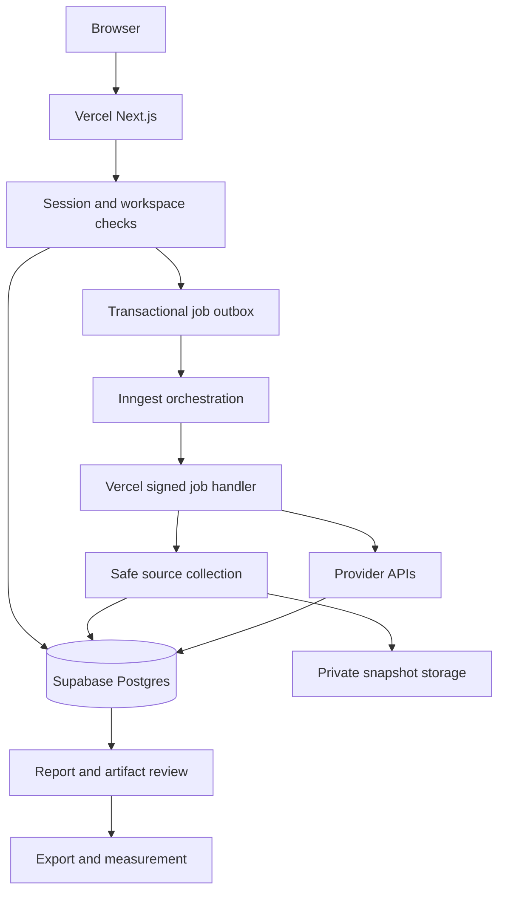

# TableSignal: development plan for any restaurant and Vercel

Reviewed 23 October 2026. Source baseline: `03de8bfa31952a0c47a02f6fec47e382b6ca98e1`.
Status: implementation plan, not an implemented cloud release. This review inspected source and existing reports; it did not rerun historical provider calls or certify deployment.

## Contents

1. Scope and priorities
2. Existing versus required development
3. End-to-end processing
4. Cloud architecture
5. Data and API contracts
6. Implementation milestones
7. Acceptance and deployment
8. Security, future work and handoff

## 1. Scope and priorities

Build one reusable product: a user enters a restaurant/cafe name, chooses the correct branch, and receives source-backed visibility analysis, observed competitors, usable drafts and honest measurement. A name alone is not a unique identity. Ask for city/address or an official URL when resolution is ambiguous. Never silently select a similarly named business.

The current product already accepts multiple restaurant profiles. This is an extension and cloud migration, not a rebuild of the analysis logic. Gandhi Cafe and John's of Bleecker Street remain dated case studies; Linden Table remains synthetic. Café Athena is an event demo profile, not a condition inside application logic.

The organizer README at `cebc02b86bde653215b58d60b5183c4bf2c25f39` specifies Café Athena in Pacific Beach, San Diego for the demo. Do not give it NYU questions. The general product must also work for another cafe without changing code. The user's new multi-restaurant/cloud direction supersedes older NYC-only next steps and the old “no stack migration” recommendation. Preserve all historical evidence and existing safeguards.

Distinguish three scopes:

- Event deliverables: working Athena demo, competitor visibility report, actionable assets, and measurement. Actual permissioned publication is a bonus.
- Product PRD v1.1: additionally includes controlled experiments, replay, scheduling/trends, off-site evidence and broader artifacts. These remain open requirements, not completed features.
- This development plan: establishes the cloud foundation and general onboarding first, then closes those product gaps. A reduced demo must explicitly list any remaining v1.1 gaps.

## 2. Existing versus required development

“Present” below means present in inspected source; historical test counts are not a new validation run.

| Capability | Existing code / evidence | Required change |
|---|---|---|
| Multiple restaurants | `server/index.ts` POST/PATCH restaurants; selector in `src/App.tsx` | Keep; replace example-led onboarding with branch resolution and explicit selection |
| Input | Requires name, website, location; optional cuisine/aliases | Name-first search candidates; URL path; manual fallback; website optional when unavailable |
| Identity | Reviewed identity and aliases | Structured branch address, optional place ID/coordinates, duplicate detection and ambiguity UI |
| Questions | `shared/questions.ts`: 20 neutral templates | Cafe/restaurant intent packs, locale/currency, geography; remove implicit seasonal cuisine and universal USD budgets |
| Source collection | `server/collector.ts`, `server/evidence.ts`: bounded HTML and fact review | Async cloud steps; structured coverage; unsupported PDF/image/JS states and reviewed imports |
| Live answers | `server/providers.ts`, `server/codex-provider.ts` | Reuse provider contract; production API adapter only; verify a real API smoke run |
| Parsing / metrics | `shared/parser.ts`, `shared/metrics.ts` | Preserve arithmetic and comparability; reviewed branch-aware entity resolution |
| Competitors | `server/competitive-evidence.ts`: observed top competitors and cited websites | Fix alias grouping through versioned review; never merge branches by name alone |
| Diagnosis | `server/real-analysis.ts`: evidence-linked rules | Generic checks plus validated LLM synthesis; isolate pizza-specific 14/16-inch rule |
| Content | `server/content.ts`: about, FAQ, Restaurant/Menu JSON-LD and versions | Add remaining PRD types; safe source-grounded generation; no unsupported facts |
| Persistence | `server/store.ts`: SQLite JSON records | Async repository interface, Postgres, private object storage, controlled migration |
| Execution | `server/index.ts`: process worker every 75 ms | Durable jobs, checkpoints, idempotency, retries and cancellation |
| UI | React/Vite, large `src/App.tsx`, local selected restaurant | Reuse components in Next.js; workspace/restaurant-scoped pages and paginated data |
| Historical evidence | `reports/`, `docs/PROGRESS.md` | Reports are not raw run imports. Preserve original data if provided; never reconstruct answers from percentages |
| Live comparison | Saved-bank reruns and compatibility gate | Keep and test after migration; add per-provider views |
| Controlled experiment | Not implemented | Versioned A / A-repeat / B, fixed retrieval and saved chunks |
| Replay / schedule / trends | Not implemented as specified | Snapshot replay, durable scheduled jobs, comparable time series |
| Cloud security | Local single-operator app | Auth, membership, RLS, secure worker boundaries, limits and deployment checks |
| Publication | Export only | Keep export as core; approval-bound sandbox publish optional |

Specific debt: Gandhi's report records Masala Times name variants split into separate competitors. Correct through new extraction/entity-resolution versions; do not rewrite raw answers. `scripts/setup-nyc.ts` and `scripts/run-nyc.ts` still target John's. Keep them historical; do not use them as the new generic onboarding pipeline.

## 3. End-to-end processing

1. **Resolve identity.** Accept `{name, city?, address?, website?}`. A server-side business-search adapter returns candidates with address, URL, source and optional coordinates. If no configured search service, request location/URL manually; do not fabricate candidates. Present uncertain matches for confirmation. Website discovery is untrusted input too.
2. **Save branch and scope.** Create an opaque restaurant ID within the workspace. Store business type, locale, currency, timezone, aliases and reviewed address. Name/address entered by a user is manual input, not independent website evidence or ownership.
3. **Collect public evidence.** Enqueue bounded home/menu/about/contact discovery. Fetch HTML, then extract readable text, metadata, links and existing JSON-LD into our normalized records. Websites do not generally return a complete business JSON object. Save URL, retrieval time, hash, parser version and outcome.
4. **Review facts.** Display source excerpts and conflicts. Accept facts individually, keeping website/manual/owner/synthetic provenance distinct. Blocked pages and empty extraction remain unknown. Continue with limited evidence when necessary and label the limitation.
5. **Freeze questions.** Select cafe or restaurant intent templates, then review approximately 20 questions across five or more relevant dimensions. Cafe examples include coffee, breakfast, takeaway and seating; Wi-Fi suitability is a question, never an assumed fact. Unknown cuisine produces cuisine-neutral wording. Record a bank version/hash.
6. **Measure independent answers.** Ask the configured web-grounded provider each neutral question independently. Do not inject target name/profile, diagnosis or desired result. Save raw response, citations, model/settings, usage, errors and timestamps. Calculate metrics in code.
7. **Resolve observed competitors.** Take leading names from actual answers, review branch identity/aliases and collect bounded evidence. Research-only names never count as measured appearances. Import team research with source/time/excerpt; missing provenance stays unverified.
8. **Diagnose and draft.** Feed compact reviewed evidence plus computed metrics to a structured-output LLM. Return supported observations separately from hypotheses, linked actions and expected test methods. Validate schema and evidence IDs. Keep deterministic diagnosis as a fallback; report generation failure honestly.
9. **Review and export.** Generate usable copy/FAQ/schema from accepted facts, validate, show diffs and save immutable versions. Missing facts appear as editor tasks, never as placeholder values in exported structured data. An export is not publication.
10. **Measure and replay.** Rerun live questions independently; compare compatible matched answers. Separately run controlled experiments and technical checks. Preserve all outcomes, including zero change and regressions. Replay displays original mode/date without calling the model.

### Geographic scope: what does “near NYU” cover?

There is no inherent fixed radius in that phrase. Resolve the campus/landmark first. Store a scope such as `{kind: 'radius', center, radiusMeters: 1500}` only when a user selects it; 1.5 km is an illustrative product default, not an organizer/provider rule. Alternatively use a named neighborhood boundary or an explicit walking-time setting. Walking minutes require a routing service; straight-line distance cannot establish them.

Put the selected scope into questions. Model answers may still include out-of-scope businesses: save them and mark distance eligibility separately. Geocode evidence is required before filtering by radius. Missing coordinates mean “location eligibility unknown,” not excluded or zero distance. Freeze scope with the bank; changes require a new version and may invalidate comparison.

## 4. Cloud architecture

Chosen deployment target from the prior plan: Next.js App Router + TypeScript on Vercel, Supabase Postgres/Auth/private Storage, Inngest Cloud, and server-side provider APIs. Reuse the current domain modules and UI rather than replacing them wholesale.

Vercel hosts UI/API and bounded job handlers. Inngest orchestrates and retries those handlers; it is not permission to exceed Vercel function limits. Supabase stores durable state. Local SQLite, detached supervisors, CLI authentication and in-process intervals are not production services.

Extract pure `id/hash/time` utilities from `server/store.ts` before porting modules which import them; otherwise they drag `node:sqlite` into the cloud bundle. Convert storage calls to awaited async repository methods. Do not emulate `store.all()` by returning every tenant's entire history to `/api/bootstrap`.

Suggested destination layout (new, not currently present): `src/app/` routes; `src/components/` reusable UI; `src/server/services/` orchestration-free business logic; `src/server/repositories/` scoped persistence; `src/server/jobs/` Inngest handlers; `src/server/providers/` adapters; `shared/` pure contracts/metrics; `supabase/migrations/`; `tests/`. Keep legacy runtime until cloud parity is verified, then retire its production entry points explicitly.

### Durable execution

Create job and outbox row in one transaction. Return HTTP 202 with job ID; dispatch after commit. Pending outbox events are retried by a periodic dispatcher. Uniqueness constraints and leases prevent duplicate stored steps. Repeated requests with the same workspace/idempotency key and same payload return the existing job; changed payload returns 409.

One step handles a bounded page or provider request. Save each result before advancing. Use backoff with jitter/Retry-After for transient errors; no automatic retries for invalid keys or invalid input. Enforce per-workspace concurrency, global capacity and cost ceilings. Ambiguous provider timeouts can still cause duplicate billing: record uncertain attempts and avoid claiming exactly-once calls.

Statuses: queued, running, succeeded, partial, failed, cancelled. Stage and review-pending are separate fields. Review gates stop progression; resume only the reviewed version. Closing the tab does not stop accepted jobs. Cancellation prevents new work; in-flight charges may remain.

Initial configurable limits: 5 pages per business, 3 observed competitors, 20 questions, 2 concurrent provider calls, at most 2 transient retries. These are app defaults, not platform limits or a promised completion time.

## 5. Data and API contracts

Every tenant-owned row has `workspace_id`; child links must belong to that workspace and restaurant. Use composite constraints or equivalent enforced checks, not UI filtering alone.

| Entity | Required additions / invariants |
|---|---|
| Workspace / membership | user, role, verified membership; server-controlled ownership |
| Restaurant / identity revision | address, branch identifier, optional coordinates/place ID, business type, locale/currency/timezone; confirmation source |
| Scope / query bank | scope JSON, query text/intents, immutable version/hash; no target branding |
| Snapshot / fact | entity and scope, URL, fetch time/status, content hash/object key; excerpt and review state; nullable unknowns |
| Run / result / appearance | restaurant, bank, provider/model/settings, sample index, timestamps/status, raw answer/citations; parser and entity-map versions |
| Opportunity | observation, hypothesis, evidence IDs, action type, owner control, effort, priority rationale, confidence and validation method |
| Artifact / version | restaurant, type, accepted fact IDs, content hash, validation, immutable revision |
| Job / step / outbox | payload hash, idempotency key, attempts, lease, errors, spend reservation/usage, progress |
| Corpus / experiment | manifests/hashes, retrieval configuration, A/A-repeat/B runs, selected chunks, unchanged competitor manifest |
| Schedule / comparison | timezone, next run, budget, trigger; compatibility fields and matched/excluded pairs |
| Audit / approval | actor, action/time; optional publication approval tied to artifact hash and destination |

Extend existing API shapes where practical:

| Route | Behavior |
|---|---|
| POST `/api/restaurant-candidates` | Resolve name/location; return evidence-linked candidates or needs-input |
| POST `/api/restaurants` | Confirm chosen branch; create scoped record; explicit collection job |
| POST `/api/restaurants/:id/collect-sources` | 202 job ID, bounded collection |
| POST `/api/sources/:id/review` | Review facts with original provenance intact |
| POST `/api/restaurants/:id/query-banks` | Freeze reviewed questions and geography |
| POST `/api/runs` | Validate bank ownership/settings/budget; 202 job/run IDs |
| GET `/api/jobs/:id`, `/api/runs/:id/results` | Scoped progress and paginated observations |
| POST `/api/runs/:id/collect-competitor-sources` | Observed, resolved competitors only |
| POST `/api/opportunities/:id/artifacts` | Generate validated draft/version, async when needed |
| GET `/api/artifacts/:id/export` | Authorized safe download of exact version |
| POST `/api/experiments` | Freeze corpus and settings; enqueue three arms |
| POST `/api/schedules`, GET `/api/restaurants/:id/trend` | Authenticated scheduling and mode/provider-separated series |
| GET `/api/replays/:id` | Read-only saved snapshot; original timestamp/mode |
| `/api/inngest` | SDK-supported signed handler; not a user-session endpoint |

Validate bodies with runtime schemas, bound sizes, use explicit errors (400 invalid, 401 unauthenticated, 403 unauthorized, 409 conflict, 429 limits). Never trust supplied workspace IDs without membership checks. Account for cache keys and object-store paths as well as database authorization.

### LLM boundaries and measurement

Give diagnosis/generation only the needed evidence; use JSON-schema validation and at most one bounded repair. Unknown source IDs or unsupported claims fail validation. Priority is a transparent product heuristic based on evidence strength, affected queries, effort and owner control—not an undisclosed organizer score.

Keep existing mention/recommendation/position/share/coverage arithmetic. Failed answers lower coverage, not the target's recommendation rate. No valid answers means unavailable. Version extraction corrections and recompute derived metrics explicitly; raw responses stay immutable.

For controlled A/A-repeat/B, freeze competitor content, bank, model/prompt, sample count, chunking, retriever, context budget and settings. B changes only approved target content. Use deterministic keyword/BM25 retrieval initially; save retrieved chunks and scores. Disable web tools. Show answerability/citation accuracy and recommendations. A repeat is a noise check, not proof of statistical significance. Technical schema/DOM/speed effects require corresponding technical tests; a text-only experiment cannot prove them. Live public results never establish causation from one edit.

## 6. Implementation milestones

Implement each milestone as a reviewable change; update the checkpoint with actual tests and remaining gaps.

| Order | Work and main files | Exit gate |
|---|---|---|
| M0: preserve baseline | Read AGENTS/PRD/checkpoints; capture branch and isolated tests/build; inventory `data/` without committing it | Baseline results and limitations recorded; no historical data overwritten |
| M1: cloud vertical slice | Storage interfaces from `server/store.ts`; migrations/Auth/RLS; Next shell; port one restaurant read/write route | Deployed preview creates and reloads a restaurant; another workspace cannot access it |
| M2: durable pipeline | Extract services from `server/index.ts`; outbox/Inngest; API provider adapter; bounded fetch | Real source + one configured provider answer survives browser close/retry; keys absent from client |
| M3: arbitrary business | Candidate resolver/manual fallback; branch review; optional website; generic questions; source review | Two unrelated businesses plus ambiguous name and no-site case work without code edits |
| M4: full report/action | Port existing metrics/parser/content; resolve competitor aliases; off-site import; schema-validated synthesis | Every figure traces to raw answers; each action to evidence; export contains no invented facts |
| M5: proof and demo | A/A-repeat/B, replay, scheduler/trends, remaining v1.1 artifacts | Three-arm experiment works honestly; saved replay; scheduled run observed; missing features disclosed |
| M6: release | Vercel smoke/security checks, responsive UI, docs and rollback procedure | Deployed acceptance matrix passes; production claim supported by evidence |
| Future | Broader extractors, multi-provider maturity, sandbox publishing, governance | Separate scoped work after core demo |

Do not start all feature work before M1/M2 prove the hosting path. For a short demo, prioritize one API provider, reviewed imports and export-only actions. Defer publication, advanced OCR/browser extraction and GRC. Controlled experiment, evidence and replay remain explicit v1.1 priorities; do not silently declare that PRD complete without them.

## 7. Acceptance and deployment

### Essential acceptance cases

- Gandhi, Athena and an unrelated cafe get separate IDs, facts, banks, competitors and artifacts. Refresh/switching never leaks prior-business data.
- Ambiguous same-name branches require selection; same-chain branches remain distinct; unsupported name-only search falls back to manual input.
- Cafe questions are appropriate; no NYU, dollar-price or pizza-size assumptions leak into unrelated locales. No target name/profile enters independent live prompts.
- Missing site, 403/robots block, unsupported PDF and contradictory hours produce explicit limitations, not invented facts.
- Duplicate job delivery produces one stored logical result; partial provider failures retain successful results and correct coverage.
- Cross-workspace access to every ID-based read/write/export/job/object is denied. Anonymous callers cannot start paid work.
- Unsafe URL redirects/private addresses are rejected; crawled prompt injection cannot execute tools or alter instructions.
- Live comparison rejects incompatible settings/scope; controlled competitor hashes match; replay is clearly dated and makes no provider calls.
- Build/type checks and existing domain tests pass after migration; relevant new integration tests run against isolated storage. No default SQLite deletion.
- Preview tested from another device; refresh and redeploy preserve data; signed Inngest callback reaches preview; job resumes after interruption.

### Deployment sequence

1. Pin compatible stable dependencies and lockfile; select a supported Node runtime for both CI and Vercel. Existing legacy tests require Node 24+; confirm support before configuring cloud runtime.
2. Provision separate preview/production Supabase projects or genuinely isolated environments. Apply migrations as a controlled release step, not on cold start. Enable RLS and private storage policies.
3. Configure Supabase Auth redirect URLs for intended domains. Verify sessions server-side and apply membership checks. Use the current documented SSR client pattern.
4. Configure provider API key/model and Inngest signing/event keys server-side. Only Supabase URL/publishable client key may be public with working RLS; privileged keys never receive a public prefix. Maintain `.env.example` with names/placeholders only.
5. Deploy Next.js preview from the same repo with verified build commands. No runtime references to localhost, `npm run up`, `node:sqlite`, Codex subprocesses or writable local persistence.
6. Register signed Inngest endpoint; ensure deployment protection permits authenticated callbacks through a documented integration. Run a real bounded provider smoke call within the configured budget.
7. Test migrations/imports on a copy. Legacy import preserves IDs, raw hashes, timestamps and modes; records receive a designated workspace. Validate counts/hashes and foreign keys; keep original SQLite backup. No raw DB present means no historical import—reports alone cannot populate raw answer replay.
8. Run acceptance matrix, record deployed URL/commit/configuration and results, then promote. Keep previous release and backup available; use backward-compatible migrations so code rollback remains viable.

Operational targets must be measured: fast status responses, bounded per-step execution, visible cost and errors. No claim of unlimited scaling, guaranteed completion time or zero downtime follows from choosing Vercel.

## 8. Security, future work and handoff

### Required for the hosted demo

Verified sign-in for writes/cost; server membership checks plus RLS; private snapshots and authorized expiring downloads; signed job callbacks; server-only secrets; request and cost limits; input validation and escaped rendering; audit records without credentials. Privileged workers bypassing RLS must independently enforce persisted workspace scope.

For arbitrary-domain collection, validate scheme/port/credentials, DNS results and every redirect, reject all non-public IPv4/IPv6 destinations, and bind the validated resolution to the request or use a secure fetch proxy to address DNS rebinding. Limit content/decompression size/time and respect robots. Do not solve arbitrary-domain support by disabling protections. A temporary demo allowlist must be visibly documented as limited coverage.

Treat crawled text as untrusted data, never model instructions. No fetched script execution. Apply origin/CSRF protections to cookie-authenticated mutations, safe content headers/CSP and redacted logs. Export is allowed; publishing to a third-party restaurant or sending outreach is not implied by analysis.

### Future phase: governance and production hardening

Role administration/MFA/SSO, access reviews, retention/deletion, vendor/data-flow inventory, risk ownership, backup restore drills, alerting/SLOs, incident response, dependency/secrets scanning, model-evaluation regression sets and change approval records. These are future controls, not claims of certification or regulatory compliance.

Add PDF/OCR/rendered-page workers separately when needed; multi-provider metrics; reviewed place/entity services; permissioned sandbox publishing with approval bound to exact content hash/destination, read-back verification and rollback. Editing invalidates approval. Google Opal can prototype evidence-to-draft flows, but is not the runtime or an assumed source-code exporter for this Vercel app.

### Continue with Claude Code or Codex

The portable skill is `skills/tablesignal-development/SKILL.md`; explicitly tell the coding assistant to read it. This repo path does not claim automatic registration in either tool. For automatic discovery, use the tool's documented installation mechanism; retain this canonical repo version.

Paste this prompt from the repo root:

> Read AGENTS.md, development.md, and skills/tablesignal-development/SKILL.md. Inspect the current branch and checkpoint before editing. Continue the next incomplete milestone in this same repository. Preserve historical evidence and reuse existing domain logic. Build for Vercel with durable cloud storage/jobs and arbitrary restaurant onboarding. Record tests and blockers truthfully; do not fabricate results, publish restaurant content, or start unbudgeted provider calls. Start with M0 and the smallest deployable M1 slice if no migration exists yet.

### Source references

- Current implementation: commit above, `README.md`, `AGENTS.md`, `docs/PROGRESS.md`, `docs/vasu-handoff.md`, `docs/brief-validation.md`, `PRD.md`, and source paths in the comparison table. Old checkpoint counts describe old runs.
- Organizer requirements: https://github.com/DJPulseFoundry/Pulse-Foundry-X-NYU-SPS-Hackathon at commit noted above. Submission is on Pulse; no Vercel requirement or preset judging query bank is disclosed there.
- Vercel function constraints: https://vercel.com/docs/functions/limitations
- Inngest serverless HTTP serving: https://www.inngest.com/docs/learn/serving-inngest-functions
- Supabase SSR authentication: https://supabase.com/docs/guides/auth/server-side/nextjs
- Supabase RLS: https://supabase.com/docs/guides/database/postgres/row-level-security

Cloud documentation checked 23 October 2026. Confirm versions, plan limits and API support during implementation; this plan does not pin undocumented platform quotas.
