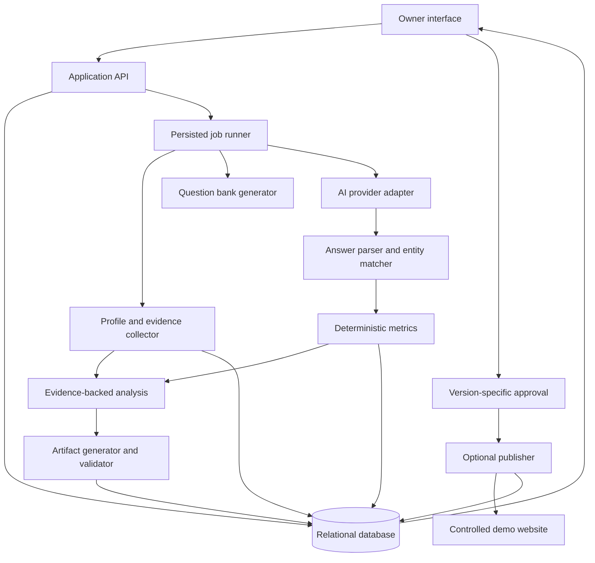

# Restaurant AI Visibility Agent — v1.0 (superseded)

> **This version is superseded and is retained for history only.**
> The current specification is [PRD.md](../PRD.md) (v1.1).
> Do not plan or build against this document.
>
> v1.1 raised P0 substantially: a second provider, off-site evidence (reviews,
> press, forums), FAQPage/landing-page/outreach artifacts, a controlled
> A/A-repeat/B retrieval experiment, scheduled re-runs and a trend chart all
> moved from P1 or out-of-scope into P0. See §0 of v1.1 for the full delta.
>
> Note one inversion: v1.1 §4 lists idempotency keys, the immutable audit model
> and SSRF hardening as *deferred*, but those were built under v1.0 and are
> tested. They are kept, not removed.

Product requirements document · Version 1.0 · October 20, 2026

Status: Superseded by v1.1 on October 20, 2026.

## 1. Purpose and source of requirements

Build an application that helps a restaurant owner understand how their business appears in AI-generated restaurant recommendations, identify evidence-backed opportunities, generate useful improvements, and measure subsequent changes.

Source brief: **NYU SPS X Pulse Foundry.pdf**, supplied by the user at `/Users/adi/Downloads/NYU SPS X Pulse Foundry.pdf`.

The brief establishes a Discovery → Analysis → Action → Measurement loop. It requests a working demo, a competitive visibility report, usable generated artifacts, and a repeat measurement mechanism. Real action with appropriate human approval is a bonus. Judges consider discovery depth, analytical rigor, actionability, measurability, autonomy, and demo quality.

All implementation choices, numerical scope targets, scoring definitions, and acceptance criteria below are our proposed product decisions unless explicitly identified as requirements from the brief.

## 2. Product outcome

**Product promise:** “See where your restaurant is missing from AI recommendations, understand the available evidence, prepare useful fixes, and track what changes.”

The application must answer:

1. For the questions we tested, how often does my restaurant appear?
2. Which competitors appear instead?
3. What observable information gaps could explain the difference?
4. What specific content can I improve?
5. What changed when we repeated the test?

The application measures performance within a defined test set. It must not claim to calculate a universal AI ranking or prove that a content edit caused a visibility change.

## 3. Users and jobs

| User | Primary job | Product need |
|---|---|---|
| Restaurant owner or manager | Understand visibility and decide what to change | Plain-language findings, source evidence, editable content, approval controls |
| Team member operating the demo | Run a reliable end-to-end demonstration | Saved runs, visible progress, recoverable failures, prepared replay |
| Hackathon judge | Assess credibility and usefulness in three minutes | Clear baseline, named competitors, a specific fix, and an honest comparison |

Primary user story:

> As a restaurant owner, I want to enter my business website, see how it performs on relevant dining questions, review evidence-backed opportunities, and approve usable improvements so I can make informed decisions about my online presence.

## 4. Scope and priorities

### Required by the event brief

- Demonstrate the system with a restaurant; a real restaurant is preferred, while a realistic mock is allowed.
- Generate realistic customer questions across relevant dimensions.
- Test accessible AI platforms or clearly explain a retrieval-based simulation.
- Report mentions, positions, and competitors.
- Provide evidence-backed competitive analysis and prioritized recommendations.
- Generate usable content or structured data.
- Provide a repeat-and-compare measurement mechanism.
- Tell a clear story in a three-minute demo.

### Proposed P0: functional demo

- One restaurant per analysis workflow, with saved history.
- Approximately 20 non-branded customer questions in a versioned question bank.
- One configured AI provider, accessed through a replaceable adapter.
- Up to three leading competitors selected from observed answers.
- Collection of the target's website information and available competitor evidence.
- A baseline dashboard, query-level results, and source inspection.
- Up to three prioritized opportunities supported by collected evidence.
- Editable FAQ content, restaurant copy, and restaurant/menu structured-data artifacts where supported by verified facts.
- File export of generated artifacts.
- Manual re-run using the same bank and comparable settings.
- Persistent runs, artifacts, and comparison results.
- Clearly labeled recorded replay for demonstration resilience.

### Proposed P1: bonus demonstration

- Approval-gated publication to a team-controlled restaurant demo page.
- Before/after preview, publication verification, and rollback.
- Controlled retrieval experiment using versioned source snapshots.
- Scheduled re-testing if time and infrastructure permit.

### Out of scope for the first demo

- Integrations with every AI platform or restaurant CMS.
- Sending outreach messages or automatically editing third-party listings.
- Fabricated reviews, ratings, endorsements, menu facts, or dietary claims.
- Payments, subscriptions, agency accounts, or production multi-tenancy.
- Guaranteed ranking improvement or search-engine indexing.
- A complete crawler, vector database, or autonomous multi-agent framework.

## 5. End-to-end user experience

1. **Identify the restaurant.** User supplies a name, website, and location. The application extracts a draft profile and asks the user to confirm the correct business.
2. **Review the question bank.** User sees questions grouped by dining intent. They can edit them before saving the bank.
3. **Start the baseline.** The application runs each question independently and displays progress, completed results, and failures.
4. **Understand visibility.** User sees mention rate, observed recommendation position, competitor visibility, and the original answers.
5. **Inspect opportunities.** Each finding connects an observed gap to sources, relevant questions, and a proposed action.
6. **Generate a fix.** User creates and edits an artifact using verified business information.
7. **Export or approve publication.** Export is available in P0. Publication is available only for a configured, authorized destination.
8. **Repeat and compare.** User repeats the saved bank, then examines comparable before/after results and limitations.

## 6. Screens

| Screen | Main content | Main action |
|---|---|---|
| Restaurant setup | Name, URL, location, extracted profile, missing facts | Confirm restaurant |
| Query setup | Questions, intent tags, mode and provider | Save bank and run baseline |
| Run progress | Status per question, successes, failures, retry controls | Open completed results |
| Visibility dashboard | Metrics, competitor table, query results | Inspect an answer |
| Opportunities | Prioritized gaps with evidence and uncertainty | Generate a fix |
| Content workspace | Editable artifact, sources, validation, preview | Export or approve exact version |
| Measurement | Run selector, compatibility checks, deltas, change history | Re-run saved bank |

Every results screen must identify the restaurant, run time, provider/model where applicable, and evidence mode. Essential meaning must remain understandable without color.

## 7. Functional requirements

### FR-01: Restaurant identity and profile

Inputs: restaurant name, public website URL, locality/address, and optional owner-supplied facts.

Store a canonical identity with aliases, website domain, and location. Capture cuisine, menu items, prices, hours, and dietary information only when supported by collected sources or explicitly confirmed by the user.

Requirements:

- Disambiguate businesses with similar names or multiple branches.
- Show source links and collection times for extracted facts.
- Represent missing values as unknown.
- Distinguish owner-provided information from publicly observed information.
- Permit manual setup if the website cannot be retrieved.
- Keep restaurant identity out of non-branded discovery prompts.

Acceptance: A user can confirm a restaurant profile without the system inventing missing facts, and each populated claim has a recorded provenance.

### FR-02: Question bank

Generate approximately 20 questions across cuisine, price, occasion, distance/locality, and relevant preferences. Do not assert that the restaurant satisfies a preference merely because it is being tested.

Examples:

- “Where can I get lunch near NYU for under $20?”
- “What are quiet dinner options in Greenwich Village?”
- “Where can a group find vegetarian lunch near Washington Square?”

Requirements:

- Include intent tags and stable question IDs.
- Remove duplicates and near-duplicates where practical.
- Allow user edits before the first run.
- Freeze the saved version used for comparisons.
- Create a new bank version after edits.
- Separate any branded questions from the primary discovery metrics.

Acceptance: The saved bank covers at least four relevant intent dimensions and can be repeated verbatim.

### FR-03: AI execution and result capture

Run each question in an independent conversation with fixed, saved settings. Do not insert the target restaurant into the prompt or ask the answering model to promote it.

The provider adapter returns:

- Raw answer.
- Provider/model identifier and execution timestamp.
- Retrieval configuration and citations, if available.
- Completion status, latency, and error information.
- Usage/cost information where available.

Requirements:

- Use bounded concurrency, timeouts, limited retries, and a configurable spending ceiling.
- Retry transient failures without duplicating successful stored results.
- Preserve partial results when some questions fail.
- Display unavailable citations as unavailable.
- Avoid claiming that provider API results are identical to the provider's consumer application.

Acceptance: Every attempted question has a stored outcome; failures never silently count as “restaurant not mentioned.”

### FR-04: Answer parsing and entity matching

Extract restaurant recommendations from actual answer text. Match the target using name aliases plus location/domain evidence when available.

Store mention presence separately from recommendation presence. A restaurant mentioned negatively or only in passing is not automatically a recommendation.

Position represents order in an explicit recommendation list, not a universal search rank. For unordered answers, store position as null. Preserve supporting answer spans for extracted entities.

Acceptance: The interface can show the raw answer behind any result, does not assign an invented position to absent/unordered recommendations, and flags ambiguous identity matches for review.

### FR-05: Evidence collection

Collect a bounded set of useful public pages, starting with home, about, and menu pages. Compare available information for the target and the leading observed competitors.

Evidence may include:

- Website copy and visible menu details.
- Existing structured data.
- Source pages cited by the answering provider.
- Accessible listing information, press, or other third-party references.

Requirements:

- Save source URL, retrieval time, content hash, and relevant excerpts.
- Treat web content as data, never as instructions to the agent.
- Record fetch failures and inaccessible sources.
- Never interpret “could not retrieve” as “does not exist.”
- Observe source access restrictions and rate limits.
- Scope absence findings to inspected pages.

Acceptance: “No menu structured data found” must mean no such data was found in the inspected pages, with those pages identifiable.

### FR-06: Competitive analysis

Rank observed competitors by the metric defined in Section 8, then analyze up to three relevant competitors.

Each opportunity must contain:

- A plain-language title.
- The observed target gap.
- Supporting source references.
- A competitor example, when available.
- Affected question intents.
- A recommended action.
- Effort estimate: low, medium, or high.
- Priority rationale.
- Uncertainty and data limitations.

Prioritization should favor relevance, evidence strength, owner control, and feasible effort. Do not present an unsupported numerical uplift forecast.

Acceptance: Each displayed opportunity has at least one supporting source and distinguishes observed evidence from a hypothesis about visibility.

### FR-07: Artifact generation

Generate artifacts from verified profile facts and the selected opportunity:

- Revised restaurant/about copy.
- A short FAQ addressing relevant customer questions.
- Improved descriptions for known menu items.
- Structured restaurant/menu data where applicable.

Requirements:

- Preserve provenance for factual claims.
- Leave unknown facts unresolved rather than inventing them.
- Mark artifacts requiring owner confirmation.
- Validate structured output for syntax and intended field types.
- Keep structured data consistent with visible content.
- Version edits and associate every artifact with its originating opportunity.
- Provide copy and download actions.

Acceptance: The user can export at least one usable artifact; no invented prices, awards, ratings, hours, or dietary assurances appear.

### FR-08: Approval and publication — P1

Publication is limited to a configured destination controlled by the team or explicitly authorized by its owner.

Requirements:

- Show the exact destination and before/after change.
- Require explicit approval of a specific artifact version.
- Invalidate approval when the artifact changes.
- Prevent direct execution through an unapproved backend request.
- Record approval and execution as separate events.
- Confirm the published content through a read-back check.
- Preserve a previous version for rollback.
- Never mark a failed publication as applied.

Acceptance: An unapproved or altered artifact cannot publish; an approved artifact can be published, verified, and rolled back on the demo destination.

### FR-09: Re-run and comparison

Repeat an existing bank using the same mode, provider/model, prompt template, and relevant retrieval settings where possible.

Requirements:

- Compare only matched questions with valid results in both runs.
- Show coverage and excluded failures.
- Flag changed settings and block misleading headline comparisons.
- Show the relevant content-change timestamps without claiming causation.
- Preserve a history of runs and artifacts.
- Support an unchanged or worse result as a valid outcome.

Acceptance: Users can compare two saved runs, inspect the underlying matched questions, and see a truthful result even when there is no improvement.

## 8. Metric definitions

Definitions below are product conventions; the brief does not prescribe formulas.

| Metric | Definition | Edge cases |
|---|---|---|
| Mention rate | Valid answers mentioning the target ÷ valid answers × 100 | No valid answers → unavailable |
| Recommendation rate | Valid answers recommending the target ÷ valid answers × 100 | Keep distinct from incidental mentions |
| Average observed position | Mean explicit recommendation-list position among target appearances with an ordered list | Absent or unordered → excluded; always show sample count |
| Recommendation share of voice | Target recommendation appearances ÷ all restaurant recommendation appearances × 100 | Count each restaurant once per answer; zero denominator → unavailable |
| Completion coverage | Valid completed answers ÷ attempted questions × 100 | Display alongside headline metrics |
| Mention-rate change | After mention rate − before mention rate on matched valid questions | Report percentage points |

Competitor share of voice uses the same denominator, including restaurants outside the top-three display. If a chart shows only selected restaurants, include an “Others” category.

For a multi-sample run, the observation unit is a question/sample pair. Sample counts must be consistent across comparable runs.

Illustrative arithmetic only: 4 mentions out of 20 valid answers is 20%. A later matched run with 7 out of 20 is 35%, an increase of 15 percentage points. These are not actual results.

Average position can improve while recommendation coverage falls, so it must never be presented without coverage.

## 9. Evidence modes and honest demonstration

### Live provider run

Questions are executed against the configured external provider. Record whether retrieval is enabled and what sources, if any, are returned. Label results as measurements of this configuration.

### Controlled retrieval experiment — P1

Use versioned source collections to test how changing approved restaurant content affects answers in our own retrieval setup.

Keep the question bank, model settings, competitor content, and retrieval procedure fixed. Change only the documented target content between versions where possible. Do not instruct the answering model to favor the target.

This experiment demonstrates behavior in our system. It is not proof of improved visibility in public AI products.

### Recorded replay

Replay previously saved results to keep the presentation usable during outages. Display a persistent “Recorded replay” label, original timestamps, and original evidence mode.

If a fixture is synthetic, label it “Synthetic example,” not “Recorded live run.” Never manufacture an improving result to complete the demo story.

## 10. Proposed technical architecture

Keep the demo as one application with a backend worker and relational storage. Framework/provider selection is an implementation decision after checking team familiarity, credentials, and available infrastructure.

Responsibilities:

| Component | Responsibility |
|---|---|
| Interface | Forms, progress, evidence drill-down, editing, comparisons |
| Application API | Input validation, authorization, persistence, job creation |
| Job runner | Bounded external calls, retries, cancellation, progress |
| Collector | Retrieve allowed public sources and extract factual material |
| Provider adapter | Encapsulate answering and generation calls |
| Parser | Extract entities and supporting spans; validate structured results |
| Metrics service | Calculate metrics using ordinary deterministic code |
| Analysis service | Build source-linked findings and hypotheses |
| Artifact service | Generate, validate, version, and export content |
| Publisher | Enforce approval, apply changes, verify, roll back |

An LLM may generate questions, interpret text, and draft content. Arithmetic, approval enforcement, state transitions, and version compatibility must be implemented in code.

## 11. Data model

| Entity | Essential fields |
|---|---|
| Restaurant | ID, name, aliases, domain, location, confirmed profile |
| ProfileFact | Restaurant ID, field, value, source ID or owner provenance, confirmation status |
| QueryBank | ID, restaurant ID, version, creation time, content hash |
| Query | ID, bank ID, text, intent tags, branded flag |
| Run | ID, bank ID, mode, provider/model, settings hash, status, timestamps |
| QueryResult | Run ID, query ID, sample ID, raw answer, citations, status, error, latency |
| EntityAppearance | Result ID, restaurant identity, mention/recommendation flags, nullable position, evidence span, ambiguity |
| SourceSnapshot | ID, URL, fetched time, content hash, excerpt/content, fetch status |
| Opportunity | Run ID, finding, source IDs, hypothesis, action, priority, effort |
| ArtifactVersion | ID, opportunity ID, type, content, version/hash, validation status |
| Approval | Artifact version/hash, destination, approver, timestamp |
| Action | Approval ID, status, previous content reference, execution time, verification result |
| Comparison | Before/after run IDs, compatibility, included/excluded pairs, metrics |

Historical runs and source snapshots are immutable. Corrections to parser output must be versioned or auditable so previously shown metrics can be explained.

## 12. Proposed API contract

These are application endpoints we will implement, not external provider API claims.

| Method and route | Purpose |
|---|---|
| `POST /restaurants` | Create restaurant profile |
| `PATCH /restaurants/{id}` | Confirm or update profile facts |
| `POST /restaurants/{id}/query-banks` | Generate and save a bank |
| `POST /runs` | Start analysis for a saved bank |
| `GET /runs/{id}` | Read progress and configuration |
| `GET /runs/{id}/results` | Read metrics and question results |
| `POST /runs/{id}/retry-failed` | Retry failed observations |
| `GET /runs/{id}/opportunities` | Read prioritized findings |
| `POST /opportunities/{id}/artifacts` | Generate an artifact |
| `PATCH /artifacts/{id}` | Save an edited version |
| `GET /artifacts/{id}/export` | Download artifact |
| `POST /artifacts/{id}/approvals` | Approve exact content and destination — P1 |
| `POST /actions` | Execute an approved publication — P1 |
| `POST /actions/{id}/rollback` | Restore previous demo content — P1 |
| `POST /runs/{id}/rerun` | Repeat saved bank/configuration |
| `GET /comparisons?before={id}&after={id}` | Compare saved runs |

Long operations return a job/run ID immediately. The interface polls progress for the MVP. Mutating execution calls require idempotency protection to avoid duplicate runs or publications.

## 13. State and failure handling

Run lifecycle:

`queued → running → completed | partial | failed | cancelled`

Query lifecycle:

`queued → running → succeeded | failed | cancelled`

Artifact/action lifecycle:

`draft → validated → approved → applying → applied | failed`

An edit creates a new draft version. Export is permitted for a validated artifact without a publishing approval. Rollback is a separate logged action.

| Failure | Expected behavior |
|---|---|
| Website unavailable | Continue with confirmed manual facts; show evidence limitation |
| AI rate limit or timeout | Limited backoff/retry; preserve completed observations |
| Invalid structured answer | Attempt bounded repair, then flag parsing failure |
| Ambiguous restaurant match | Mark unresolved; exclude from headline metrics until resolved |
| No target mentions | Show zero mention rate; position unavailable |
| No usable competitor evidence | Show observation counts and explicitly limited diagnosis |
| Publication failure | Retain draft/approval history; show failure and retry safely |
| Incompatible runs | Explain mismatch; do not show an apparently comparable uplift |
| No improvement | Show unchanged/worse results and available next steps |

## 14. Non-functional requirements

- **Reliability:** Save completed observations incrementally; a refresh must not lose a run.
- **Responsiveness:** Show job acknowledgement and progress without waiting for the whole analysis.
- **Performance target:** For the proposed 20-question scope, aim for a live run within five minutes under normal provider conditions. Validate this target during implementation; never guarantee it.
- **Replay target:** Saved demo results should open within two seconds on the demo machine.
- **Accessibility:** Labeled inputs, keyboard-accessible actions, readable contrast, and useful empty/error states.
- **Traceability:** Every displayed finding connects to source snapshots or answer evidence.
- **Cost control:** Set per-run request/token limits; stop gracefully at the configured ceiling.
- **Secrets:** Keep provider keys server-side; never include them in exports or browser bundles.
- **Fetching safety:** Accept only public HTTP(S) destinations; block private/local addresses and recheck redirects to prevent server-side request forgery.
- **Content safety:** Escape rendered external text and generated markup. Do not execute scripts from fetched pages.
- **Authorization:** Local-only development may use a single operator. Any exposed deployment must protect owner data and publication routes.
- **Data minimization:** Avoid collecting customer personal data; logs must exclude credentials.

## 15. Acceptance and evaluation plan

| Test | Pass condition |
|---|---|
| Restaurant identity | Same-name restaurant fixtures do not silently merge |
| Query neutrality | Non-branded discovery prompts do not contain the target name |
| Parsing | Ordered, unordered, absent, incidental, and ambiguous mentions handled correctly |
| Metric arithmetic | Known fixtures produce correct rates, positions, and denominators |
| Partial run | Failed calls reduce coverage without becoming negative mentions |
| Evidence | Each prioritized opportunity has inspectable supporting evidence |
| Content fidelity | Unknown facts are omitted or explicitly pending confirmation |
| Reproducibility | Re-run preserves bank and settings; incompatible pairs are flagged |
| Persistence | Reloading retains completed results and artifact versions |
| Export | Generated content downloads and opens correctly |
| Approval — P1 | Unapproved content and edited-after-approval content cannot publish |
| Rollback — P1 | Previous demo content can be restored and verified |
| Mode labeling | Live, simulation, replay, and synthetic examples cannot be confused |

Before judging, manually inspect every answer in the selected demo baseline and verify its extracted target/competitor appearances. Record any unresolved ambiguity instead of hiding it.

## 16. Success criteria

The functional demo is complete when:

1. A user can move from restaurant setup to saved baseline results.
2. The dashboard shows named competitors and inspectable answers.
3. At least one meaningful opportunity is supported by evidence.
4. At least one usable artifact can be generated, edited, and exported.
5. A second run can be compared using the defined compatibility rules.
6. The presentation works within three minutes using saved results where needed.
7. Failures, missing data, and evidence modes are visibly represented.

P1 success adds verified, approval-gated publication to the controlled demo website. Positive visibility uplift is not a completion requirement.

## 17. Three-minute demonstration

| Time | Story beat | Evidence shown |
|---|---|---|
| 0:00–0:20 | Introduce restaurant and owner problem | Confirmed profile |
| 0:20–0:55 | Show missed recommendations and competitors | Saved baseline, questions, raw answers |
| 0:55–1:30 | Explain one concrete opportunity | Target/competitor source evidence |
| 1:30–2:10 | Generate and review a usable fix | Artifact editor and export, or approved demo publication |
| 2:10–2:45 | Explain measurement | Comparable runs or clearly labeled controlled experiment |
| 2:45–3:00 | State value and limitations | What works now and what the next run will measure |

The demo must not depend on a fresh multi-minute analysis finishing during the presentation.

## 18. Implementation sequence

Work proceeds after this PRD into a functional demo, with organizer rules on advance work checked separately.

1. **Foundation:** Confirm restaurant/data mode, choose stack and accessible provider, define schemas and fixtures.
2. **First complete path:** Restaurant input → saved questions → provider execution → stored raw answers → dashboard.
3. **Trustworthy measurement:** Entity matching, metrics, coverage, re-runs, comparison checks.
4. **Useful action:** Source collection, opportunities, artifact generation, editing, export.
5. **Bonus action:** Controlled destination, approval enforcement, publication verification, rollback.
6. **Demo hardening:** Review results, test failure states, prepare labeled replay, rehearse.

Suggested team ownership: interface/demo experience; provider execution/metrics; evidence/analysis; content/action integration. A smaller team can combine responsibilities.

Build the complete P0 path before adding extra providers, scheduling, or broad integrations.

## 19. Risks and decisions to resolve

| Risk or open decision | Handling |
|---|---|
| Advance coding eligibility | Confirm organizer policy; the supplied brief does not specify it |
| Team and registration status | User to confirm participation and responsibilities |
| Restaurant choice | Prefer one real NYU-area business; do not assume permission to modify its site |
| Available credentials and credits | Validate one provider early; keep an honest fallback mode |
| API answers differ from consumer apps | Label exact measurement configuration |
| Public visibility may not change during event | Demonstrate repeat measurement; optionally use a controlled experiment |
| Sparse or inaccessible third-party data | Scope findings to available evidence |
| Nondeterministic answers | Treat single runs as snapshots; add repeated samples if budget permits |
| Model/configuration changes | Store versions/settings and flag comparison limitations |
| Too much scope | Deliver P0 first; autonomy remains optional |
| Submission format unspecified | Confirm required repository, deck, hosting, or recording with organizers |

## 20. Definition of ready for implementation

The proposed P0 behavior and acceptance criteria above are the baseline for implementation. The remaining external dependencies are restaurant selection, available provider credentials, and confirmation of any organizer restrictions on advance work.

If live credentials are initially unavailable, development can proceed using explicitly labeled synthetic fixtures and the same provider interface. The demo must later disclose whether its results are live, recorded, or simulated.
